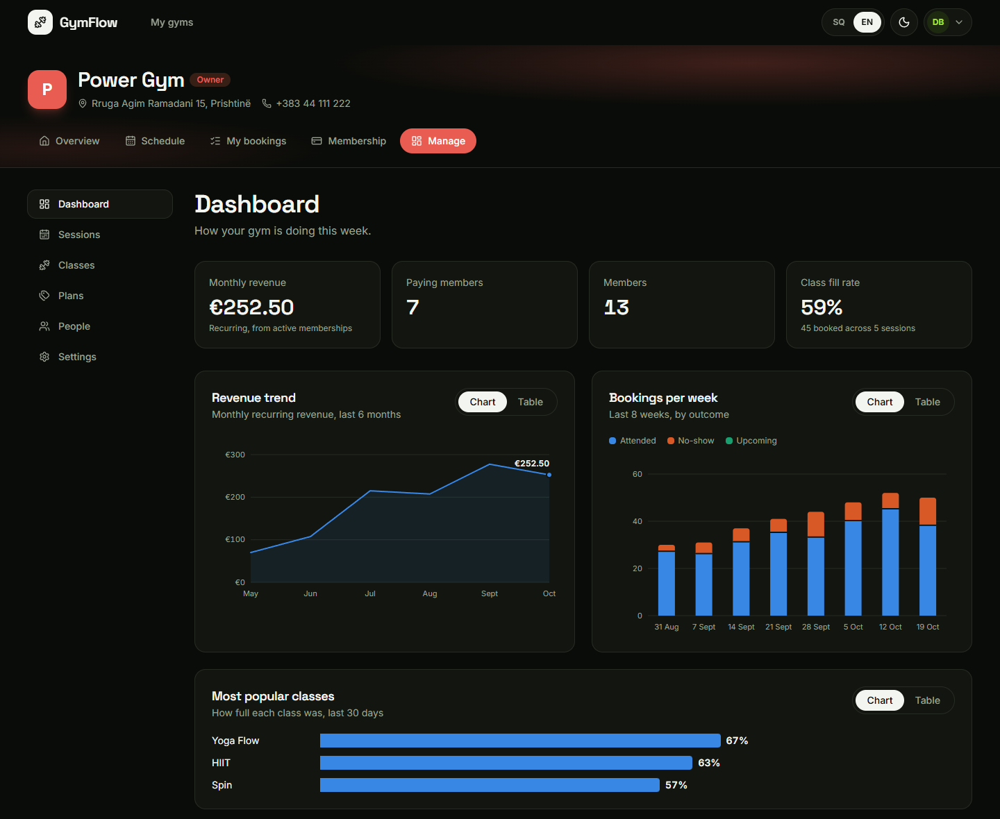
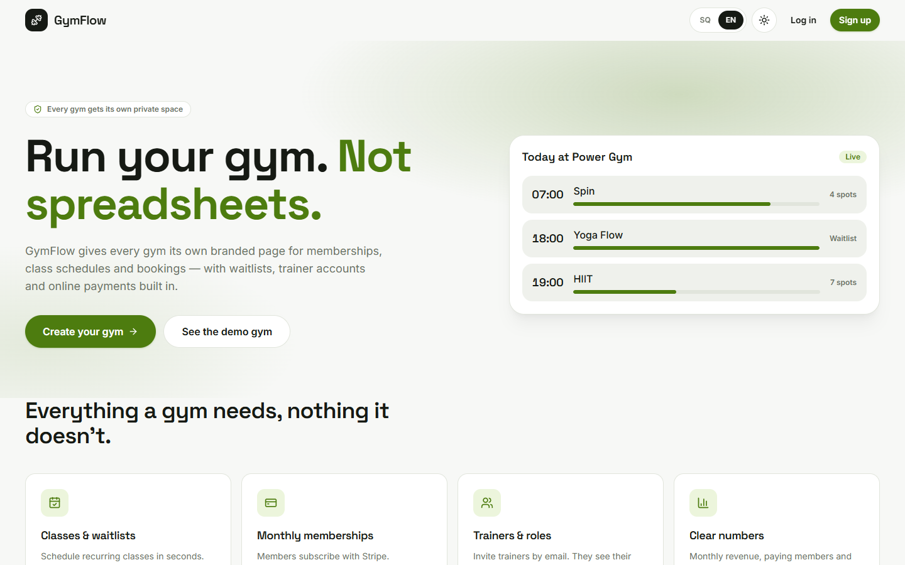
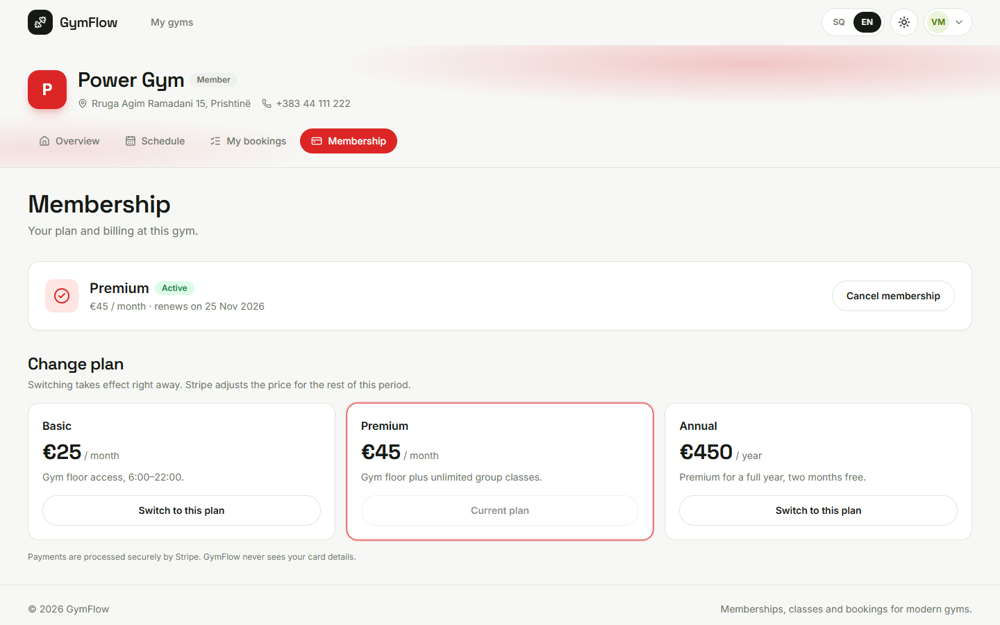
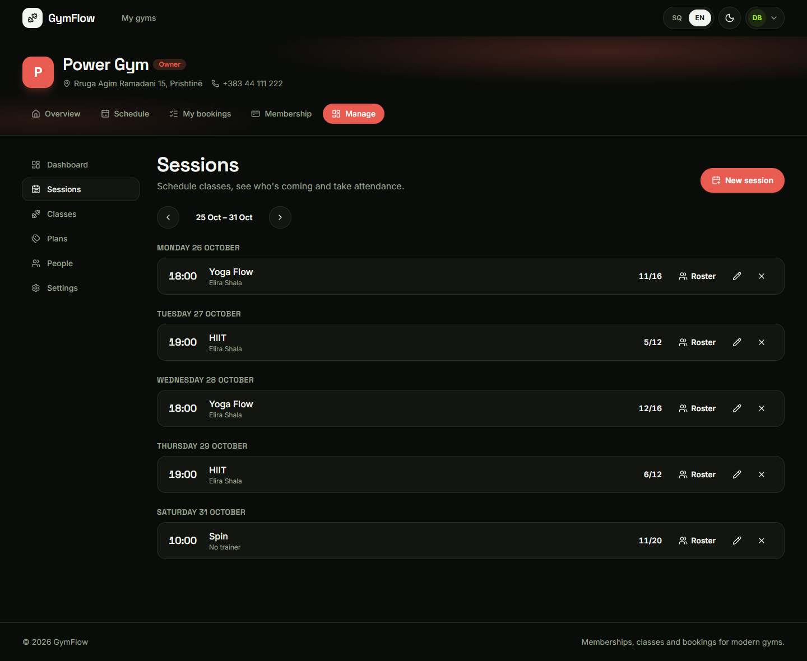
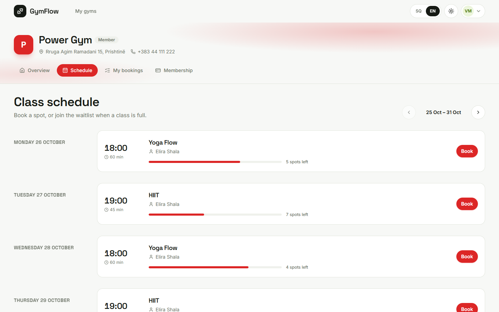
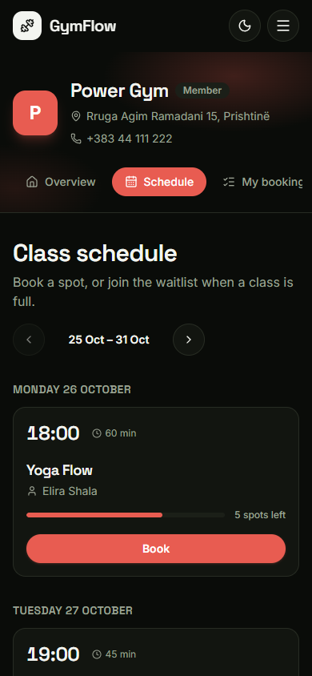
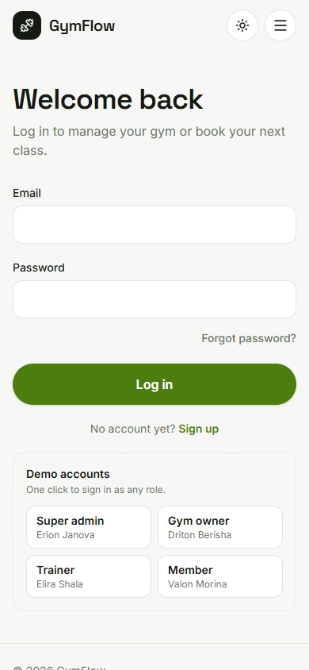

# GymFlow

**Run your gym. Not spreadsheets.**

GymFlow is a multi-tenant SaaS for gyms. Every gym that signs up gets its own branded page where members subscribe to a plan, book classes and join waitlists, trainers take attendance, and the owner sees how the business is doing.

I built it to learn the parts of real SaaS work that a normal CRUD app never touches: keeping each gym's data strictly separate, handling payments and their edge cases, and making sure two people can't grab the last spot in a class at the same time.



## Try it

You only need Docker.

```bash
git clone https://github.com/erionjanova/gymflow.git
cd gymflow
docker compose up --build
```

Open **http://localhost:8080** and use the demo buttons on the login page. Each one signs you in with a single click.

| Role | Name | What to look at |
|---|---|---|
| Super admin | Erion Janova | Every gym on the platform, suspend or reactivate a gym |
| Gym owner | Driton Berisha | Dashboard and charts, sessions, plans, people, invites |
| Trainer | Elira Shala | Their own classes, rosters, attendance |
| Member | Valon Morina | Schedule, bookings, waitlist, membership |

The demo gym comes with six months of history so the charts have something to show. Payments run in demo mode, so you can subscribe, switch plans and cancel without a card. Every email the app sends (invites, password resets, "you got a spot" notices) lands in a local inbox at **http://localhost:8025**.

## What it does

**For members**
- Browse the weekly schedule and book a spot, or join the waitlist when a class is full
- Move up from the waitlist automatically when someone cancels, and get an email about it
- Subscribe to a monthly or yearly plan, switch plans, cancel, change your mind

**For trainers**
- See only the classes they teach, check the roster and mark who showed up

**For owners**
- Create classes and schedule them once or every week
- Invite trainers by email and manage everyone's role
- Set up membership plans and decide whether booking requires an active one
- A dashboard with monthly revenue, paying members, weekly bookings and the most popular classes

**For the platform admin**
- See every gym on GymFlow and suspend one if needed

The whole app works in **Albanian and English**, including the emails, which go out in each person's own language. It has a light and a dark theme and works on anything from a small phone to a 4K screen.

| | | |
|---|---|---|
|  |  |  |
|  |  |  |

## How it works

### One database, many gyms

All gyms share one Postgres database. Every gym-owned table has a `TenantId`, and the URL decides which gym a request is for: anything under `/api/g/{slug}/...` goes through a middleware that loads the gym and the user's role in it.

From there, EF Core does the hard work. A global query filter adds `WHERE tenant_id = @current` to every query, so a controller can't forget it. On save, new records are stamped with the current gym automatically, and writing to another gym's record throws before anything reaches the database. There's a dedicated test suite that tries to break this from every angle: reading by id, updating, inserting with a fake `TenantId`, listing members.

### The last spot in a class

Bookings were the most interesting part. If a class has one spot left and two people press "Book" at the same moment, only one of them can get it.

Each session has a row version. When two bookings collide, one save fails with a concurrency error, gets retried with fresh data and ends up on the waitlist instead. A unique index stops the same person from booking twice. The tests send twelve bookings at a five-spot class at the same time and check that exactly five get a spot, never six.

The same logic handles the waitlist. When someone cancels, or the owner raises the capacity, the next people in line are promoted and emailed.

### Payments

Members pay through Stripe Checkout. In practice payments have a lot of edge cases, so most of the work went there:

- **Webhooks can be slow or arrive out of order.** Every update carries a timestamp and older events are ignored. When the member comes back from Stripe, the app also asks Stripe directly instead of waiting for the webhook, so there's no "processing..." screen that never ends.
- **Plan changes are prorated.** Switching from monthly to yearly happens right away and Stripe works out the difference.
- **Cancelling keeps access until the end of the paid period**, and the member can undo it.
- **Nobody can claim someone else's payment.** The return link is checked against the signed-in user and the gym.

Without a Stripe key, the app switches to a demo gateway that follows the same flow without any money involved. That's what the Docker setup uses.

### Everything else

- **Auth:** JWT tokens, passwords hashed with ASP.NET Core Identity's hasher, login and signup rate-limited per IP. If a token expires, the frontend logs you out cleanly instead of failing silently.
- **Invites and password resets** use random tokens that are stored only as SHA-256 hashes, expire, and work once.
- **Emails** are queued and sent in the background with MailKit, so a slow mail server never slows down a booking.
- **Charts** are plain SVG, no chart library. Every chart can switch to a table view, and the colors were checked for colour-blind readers.

## Tech stack

| | |
|---|---|
| Backend | .NET 10, ASP.NET Core, EF Core 10, PostgreSQL 17, FluentValidation, Stripe.net, MailKit |
| Frontend | React 19, TypeScript, Vite, Tailwind CSS 4, TanStack Query, React Hook Form + Zod, i18next |
| Testing | xUnit, Testcontainers (real Postgres in Docker) |
| Running it | Docker Compose, nginx |

The backend follows Clean Architecture:

```
backend/src
├── GymFlow.Domain          entities and rules, no dependencies
├── GymFlow.Application     use cases: bookings, billing, invites, insights...
├── GymFlow.Infrastructure  EF Core, Stripe, email, password hashing
└── GymFlow.Api             controllers, auth, tenant resolution
```

## Tests

```bash
cd backend
dotnet test
```

There are 93 tests: 44 fast unit tests and 49 integration tests that run against a real Postgres started by Testcontainers. Docker needs to be running. The integration tests cover the parts I'd least like to get wrong: tenant isolation, booking races, waitlist promotion, payment syncing and webhooks, invites and password resets.

## Running it for development

Start Postgres, Mailpit and Adminer:

```bash
docker compose -f docker-compose.dev.yml up -d
```

Run the API (http://localhost:5009, API docs at `/scalar`):

```bash
cd backend
dotnet run --project src/GymFlow.Api
```

Run the frontend (http://localhost:5173):

```bash
cd frontend
npm install
npm run dev
```

To use real Stripe test payments, add your test keys as user secrets. They stay outside the repo:

```bash
cd backend/src/GymFlow.Api
dotnet user-secrets set "Stripe:SecretKey" "sk_test_..."
dotnet user-secrets set "Stripe:WebhookSecret" "whsec_..."
stripe listen --forward-to localhost:5009/api/payments/stripe/webhook
```

## What I'd add next

- Deploy a live version so nobody has to run Docker to see it
- Member check-in with a QR code at the front desk
- Class packs and drop-in passes, not only subscriptions
- A CI pipeline that runs the tests on every push

---

Built by [Erion Janova](https://github.com/erionjanova).
